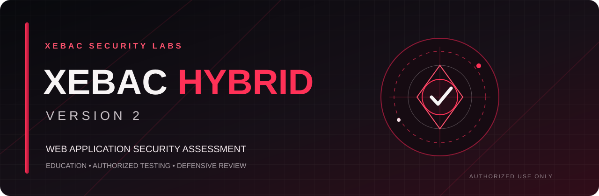

# XEBAC Auth Hardening Auditor
<svg xmlns="http://www.w3.org/2000/svg" viewBox="0 0 900 260" width="900" height="260">
  <rect width="900" height="260" fill="#0b0f14"/>
  <text x="450" y="90" text-anchor="middle" fill="#e6edf3"
        font-family="monospace" font-size="46" font-weight="bold">XEBAC · AUTH HARDENING</text>
  <text x="450" y="140" text-anchor="middle" fill="#7ee787"
        font-family="monospace" font-size="20">defensive login audit · allowlist-gated</text>
  <text x="450" y="190" text-anchor="middle" fill="#8b949e"
        font-family="monospace" font-size="16">CSRF · cookies · headers · TLS · rate-limit</text>
  <text x="450" y="230" text-anchor="middle" fill="#f0883e"
        font-family="monospace" font-size="13">authorized targets only</text>
</svg>
> **Status: Defensive release.** Audits *your own* login endpoints for missing
> protections. Read-only probing, allowlist-gated, no credential attempts.

`auth_audit.py` checks whether a login page has the defenses that attackers
look for — CSRF tokens, secure cookie flags, security headers, TLS version,
rate limiting. It does **not** attempt login, spray credentials, or send
injection payloads.



## What it checks

| Check                       | Why it matters                                   |
|-----------------------------|--------------------------------------------------|
| CSRF token in form          | Missing token enables cross-site POST forgery    |
| HSTS header                 | Prevents TLS downgrade / cookie theft in transit |
| X-Frame-Options / CSP       | Blocks clickjacking on the login page            |
| X-Content-Type-Options      | Stops MIME sniffing XSS                          |
| Referrer-Policy / CSP       | Reduces token leakage via Referer                |
| Cookie Secure / HttpOnly / SameSite | Blocks session hijack via XSS or network |
| Rate limit / lockout        | Stops credential stuffing & brute runs           |
| TLS version ≥ 1.2           | Blocks BEAST/POODLE-class attacks                |
| Certificate validity        | Sanity for handshake                             |

## Requirements

- Python 3.9+
- `aiohttp`

```bash
pip install aiohttp
